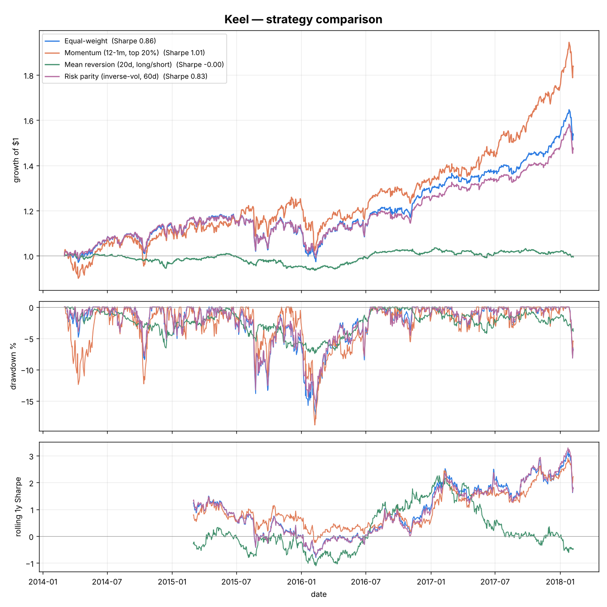

# ⛵ Keel — an honest backtesting engine

[](https://github.com/maheenniazi/keel/actions/workflows/ci.yml)


Keel backtests trading strategies the way you're supposed to: **no peeking into
the future, and you pay to trade.** It ships with real strategies, a real
S&P 500 price history, proper performance stats, and a walk-forward test that
shows how much of a backtest is just overfitting.

Most "my strategy made 400%!" backtests quietly cheat — they use information
they couldn't have had, or pretend trading is free. Keel is built to *not* do
that, so the numbers it prints are ones you could actually defend.



## Results (100 most-liquid S&P 500 names, 2013–2018, monthly rebalance, 7bps cost)

| | Equal-weight | Momentum | Mean reversion | Risk parity |
|---|---|---|---|---|
| CAGR | 11.5% | **16.7%** | −0.1% | 10.3% |
| Sharpe | 0.86 | **1.01** | −0.00 | 0.83 |
| Max drawdown | −17.8% | −18.9% | −7.4% | −16.0% |
| Turnover / yr | 0.25× | 5.72× | 16.96× | 1.49× |

What the honest version shows:
- **Momentum beats the benchmark** (Sharpe 1.01 vs 0.86) — the classic anomaly holds up.
- **Naive mean reversion dies to costs.** On paper it looks fine; after paying for
  ~17× annual turnover it nets ≈ 0%. That's the whole point — frictions matter.
- **Walk-forward keeps you humble.** `examples/walk_forward_momentum.py` picks the
  lookback on past data and trades it on unseen data; the in-sample vs out-of-sample
  gap is the overfitting tax, right there in the output.

## What makes it "honest"
- **No look-ahead.** At each rebalance the strategy only sees prices *up to that day*,
  and its weights are applied to the *next* day's returns (positions are `shift(1)`-ed).
  A signal can never trade on its own bar.
- **Real frictions.** Every rebalance pays transaction cost + slippage in proportion
  to turnover. Zero-cost backtests flatter everything; this one doesn't.
- **Benchmarked.** Every strategy is measured against equal-weight — if you can't beat
  it after costs, the signal isn't adding anything.
- **Walk-forward, not just in-sample.** The headline trap in quant research, handled.

## Strategies included
- **Momentum** — cross-sectional 12-1, long the top names.
- **Mean reversion** — z-score, dollar-neutral long/short.
- **Risk parity** — inverse-volatility weighting.
- **Equal-weight** — the benchmark.

New strategies are ~15 lines: subclass `Strategy` and return target weights from a
window of prices.

## Run it
Needs Python 3.10+. Use a virtual environment (on macOS use `python3`):
```bash
python3 -m venv .venv
source .venv/bin/activate          # Windows: .venv\Scripts\activate
pip install -e ".[dev]"

python examples/compare_strategies.py      # the table + tearsheet.png above
python examples/walk_forward_momentum.py   # out-of-sample test

pytest                                     # 15 tests
ruff check keel tests                      # lint
```

## Layout
```
keel/
  engine.py        the backtester (no look-ahead, costs, turnover, accounting)
  metrics.py       Sharpe, Sortino, CAGR, max drawdown, Calmar, turnover…
  strategy.py      the Strategy interface
  strategies/      momentum · mean_reversion · risk_parity · equal_weight
  walkforward.py   rolling out-of-sample evaluation
  tearsheet.py     metrics table + matplotlib tearsheet
data/prices.csv    bundled daily closes (built by tools_build_prices.py)
examples/          compare_strategies.py · walk_forward_momentum.py
tests/             15 tests: metrics correctness, no-look-ahead, costs, strategies
```

## Note
Backtests describe the past, not the future, and this is a research/education tool —
not investment advice. The data is real historical prices (S&P 500, 2013–2018).
